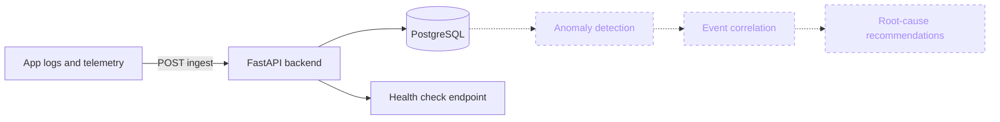

<div align="center">

  

  <a href="https://github.com/Indra9555">
    
  </a>

  <br/>

  
  
  
  

</div>

---

## `>_` BIOS / Boot Log

```text
[  OK  ] Loaded kernel module: curiosity.ko
[  OK  ] Mounted /home/indrajeet/projects
[  OK  ] Started service: java.service ............. (Android + DSA)
[  OK  ] Started service: python.service ........... (FastAPI + automation)
[  OK  ] Started service: linux.service ............ (WSL2 / Ubuntu)
[ WARN ] bugs.service restarted 47 times ........... (it's fine, we debug)
[  OK  ] Reached target: ai-ml.target .............. (in progress)
[ .... ] Waiting for: internship.target

indrajeet@dev:~$ cat mission.txt
Learn the fundamentals.
Build real projects.
Understand how systems work.
Improve through consistent practice.
```

> `Curiosity is the starting point. Consistent execution is the difference.`

---

## `🎮` Character Sheet

<div align="center">

| | |
|:--|:--|
| **Name** | Indrajeet |
| **Class** | B.Tech CSE · SRMU · batch of 2027 |
| **Main weapons** | `Java` · `Python` |
| **Side arms** | `FastAPI` · `PostgreSQL` · `Docker` · `Firebase` |
| **Home base** | Linux (Ubuntu on WSL2) |
| **Specialisation (loading)** | AI/ML · Backend · Systems |
| **Passive skills** | Debugging, patience, reading about psychology |
| **Mount** | 🏍️ Bike (for screen-break side quests) |
| **Current quest** | Land a software development internship |

</div>

### Skill tree (honest self-assessment, not a mastery claim)

```text
Java ............ ████████░░  building apps + DSA practice
Python .......... ███████░░░  FastAPI backends, scripts
Android ......... ███████░░░  ConnectHub, Firebase
Git / Linux ..... ██████░░░░  daily workflow
Databases ....... █████░░░░░  PostgreSQL, Docker setups
AI / ML ......... ███░░░░░░░  fundamentals phase  → leveling up
OS internals .... ██░░░░░░░░  VertexOS journey just begun
```

---

## `🚀` Featured Projects

### ⚡ RootCauseAI &nbsp;·&nbsp; *in development*
Find out **why** software broke, not just that it broke.



<sub>Solid lines are built today. Dashed purple nodes are planned, not claimed as finished.</sub>

`Python` · `FastAPI` · `PostgreSQL` · `Docker`

<div align="center">
  <a href="https://github.com/Indra9555/RootCauseAI">
    
  </a>
</div>

---

### 💬 ConnectHub &nbsp;·&nbsp; *Android*
A chat and social app for Android, with real-time features powered by Firebase.

`Java` · `Android` · `Firebase`

---

### 🖥️ VertexOS &nbsp;·&nbsp; *early-stage learning*
A long-term journey from "I use Linux" to "I understand what's underneath it".

```text
Level 1  ▓▓▓▓▓░░░░░  Ubuntu on WSL2, shell workflows, Git discipline    ← you are here
Level 2  ░░░░░░░░░░  C and low-level fundamentals
Level 3  ░░░░░░░░░░  Boot process, memory, processes
Level 4  ░░░░░░░░░░  A tiny kernel of my own
```

<sub>Levels 2 to 4 are future milestones, not completed work.</sub>

`Linux` · `Ubuntu` · `WSL2` · `Git`

---

## `📜` Quest Log

```text
[x] Build ConnectHub, an Android chat/social app (Java + Firebase)
[x] Ship the RootCauseAI foundation: FastAPI + PostgreSQL + Docker
[x] Complete summer training at Netcamp Solutions (Jun to Jul 2026)
[ ] Strengthen DSA in Java, one problem at a time
[ ] Learn the math and stats behind machine learning
[ ] Add anomaly detection to RootCauseAI
[ ] Make VertexOS boot something, anything
[ ] Land a software development internship          ← MAIN QUEST
```

<details>
<summary><b>🧪 My learning loop (click to expand)</b></summary>

```text
   ┌──────────┐    ┌───────────┐    ┌────────┐    ┌──────────┐    ┌────────────┐
   │  LEARN   │ ─▶ │ IMPLEMENT │ ─▶ │  TEST  │ ─▶ │ DOCUMENT │ ─▶ │ USE IN A   │
   │ a concept│    │  it       │    │  it    │    │  it      │    │ PROJECT    │
   └──────────┘    └───────────┘    └────────┘    └──────────┘    └─────┬──────┘
        ▲                                                                │
        └──────────────────────  repeat  ◀───────────────────────────────┘
```

</details>

---

## `🧰` Inventory

<div align="center">


<br/>

<br/>


</div>

---

## `📈` Telemetry

<div align="center">

  
  

  <br/><br/>

  

  <br/><br/>

  

  <br/><br/>

  

</div>

---

## `🕹️` Side Quests

- 🔍 **Under the hood:** I can't use a tool without wondering how it works.
- 🧩 **Puzzle mode:** big problem in, small pieces out.
- 📖 **Lore:** engineering articles, psychology and the humanities.
- 🏍️ **Bike rides:** the best debugger is a road with no screen.

<details>
<summary><b>🥚 Easter egg (click if you dare)</b></summary>

```text
indrajeet@dev:~$ sudo rm -rf doubt/
[sudo] password for indrajeet: ********
rm: cannot remove 'doubt/': Directory not empty
rm: hint: try 'git commit', 'git push', 'repeat'
```

</details>

---

<div align="center">

  <a href="https://github.com/Indra9555">
    
  </a>
  <a href="https://github.com/Indra9555?tab=repositories">
    
  </a>

  <br/><br/>

  ```text
  indrajeet@dev:~$ shutdown -h later   # not today
  ```

  **Learn continuously. Build deliberately. Improve relentlessly.**

  

</div>
