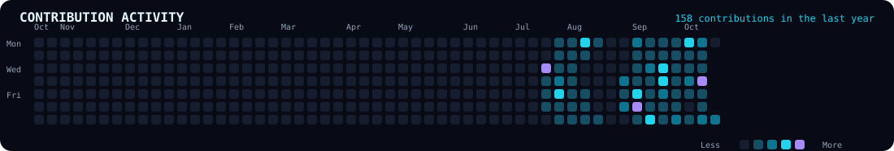

<!-- ═══════════════════════ HERO ═══════════════════════ -->

<div align="center">

  

  <a href="https://github.com/Indra9555">
    
  </a>

  <br/>

  
  
  

  <br/><br/>

  <a href="https://github.com/Indra9555?tab=repositories">
    
  </a>
  <a href="https://github.com/Indra9555?tab=overview">
    
  </a>

</div>

---

## `01` — About Me

```bash
$ whoami
Indrajeet

$ cat /etc/developer-profile
Computer Science & Engineering student
Developer in progress | Curious problem solver
Interested in AI/ML, software systems and Linux

$ current_mission
Learn the fundamentals.
Build real projects.
Understand how systems work.
Improve through consistent practice.
```

I'm a Computer Science and Engineering student focused on strengthening my programming fundamentals while building practical software projects.

I'm particularly interested in the intersection of **AI/ML, backend engineering, and system-level computing**. I enjoy exploring how software works behind the scenes, experimenting with technologies, and turning ideas into working implementations.

Rather than claiming to know everything, I believe in learning by building, debugging, documenting, and improving.

- Currently strengthening **Java, DSA, and Python**.
- Exploring the foundations of **AI/ML engineering**.
- Developing **RootCauseAI**, a platform for software failure root-cause analysis.
- Exploring Linux and operating-system concepts through **VertexOS**.
- Interested in backend systems, developer tools, and understanding technology at a deeper level.

> `Curiosity is the starting point. Consistent execution is the difference.`

---

## `02` — Featured Projects

<div align="center">

### ⚡ RootCauseAI

**AI-assisted software failure root-cause analysis**

</div>

A project focused on helping developers investigate software failures by bringing together application telemetry, logs, metrics, and potential root-cause insights.

**Current implementation highlights**
- FastAPI backend with a health-check endpoint.
- Log telemetry ingestion through an API endpoint.
- PostgreSQL-backed development environment.
- Docker-based database setup.
- A foundation for future anomaly detection, event correlation, and root-cause recommendations.

**Technology direction**

`Python` · `FastAPI` · `PostgreSQL` · `Docker` · `AI/ML`

**Status:** In development. Advanced analysis and recommendation capabilities are planned, not claimed as completed.

<div align="center">

  <a href="https://github.com/Indra9555/RootCauseAI">
    
  </a>

</div>

---

<div align="center">

### 🖥️ VertexOS

**Exploring operating-system development**

</div>

VertexOS is my long-term learning project for exploring the foundations of operating systems and Linux-based development.

The journey begins with understanding the Linux environment, development tools, command-line workflows, and the fundamentals needed to progress toward lower-level system development.

**Current focus**
- Setting up and understanding an Ubuntu environment through WSL2.
- Practising Linux commands and development workflows.
- Learning Git and maintaining a structured development process.
- Building the foundation for future OS-related implementation milestones.

**Technology direction**

`Linux` · `Ubuntu` · `WSL2` · `Git` · `System Programming`

**Status:** Early-stage learning and environment setup. Kernel development and advanced OS features are future milestones.

<div align="center">

  <a href="https://github.com/Indra9555?tab=repositories">
    
  </a>

</div>

> **Project link note:** The RootCauseAI link is included directly. The VertexOS button points to your repositories because its exact repository URL has not been confirmed. Replace that URL with the direct VertexOS repository link when available.

---

## `03` — Tech Stack

<div align="center">

### Languages


### Backend, Database & Infrastructure


### Development Environment & Tools


</div>

**Learning principle:** A technology appearing here represents my current development or learning toolkit—not a claim of professional mastery.

---

## `04` — AI/ML & Problem-Solving Journey

My long-term direction is AI/ML engineering, built on a strong foundation in programming, data structures, algorithms, and software development.

| Area | Current direction |
|---|---|
| Programming | Java and Python fundamentals |
| DSA | Structured problem-solving practice using Java |
| Mathematics | Build the foundations needed for machine learning |
| Machine learning | Study concepts, algorithms, and practical implementations |
| Projects | Apply what I learn to real software problems |
| Engineering | Improve debugging, Git workflows, APIs, and system design |

**My approach:** Learn a concept → implement it → test it → document it → use it in a project.

---

## `05` — Current Learning Roadmap

```text
[01] Programming Fundamentals
     ├── Java
     ├── Python
     └── Writing clean, understandable code

[02] Data Structures & Algorithms
     ├── Core data structures
     ├── Algorithmic problem solving
     └── Time and space complexity

[03] Software Engineering
     ├── Git and GitHub
     ├── REST APIs and backend development
     ├── Databases and Docker
     └── Debugging and testing

[04] AI / Machine Learning
     ├── Mathematics and statistics
     ├── NumPy, pandas and data analysis
     ├── ML algorithms and evaluation
     └── Practical ML projects

[05] Systems Exploration
     ├── Linux and command-line tools
     ├── Operating-system fundamentals
     └── Incremental development of VertexOS
```

This roadmap will evolve as I complete topics and gain practical experience.

---

## `06` — GitHub Activity

<div align="center">

  

  

  <br/><br/>

  

  <br/><br/>

  

## `06` — GitHub Activity

<div align="center">

  

</div>


---

## `07` — Beyond the Code

- **Technology exploration:** I enjoy understanding new tools and how they work.
- **Problem solving:** I like breaking complicated problems into manageable pieces.
- **Tech reading:** Exploring technology articles and engineering ideas.
- **Psychology and humanities:** Reading about human behaviour, thinking, and perspectives.
- **Bike rides:** Taking a break from the screen and exploring the road.

I value curiosity, patience, and steady progress over shortcuts.

---

## `08` — Connect

<div align="center">

  <a href="https://github.com/Indra9555">
    
  </a>

  <br/><br/>

  *Interested in software engineering, AI/ML, developer tools, and systems exploration.*

  **Learn continuously. Build deliberately. Improve relentlessly.**

  

</div>
