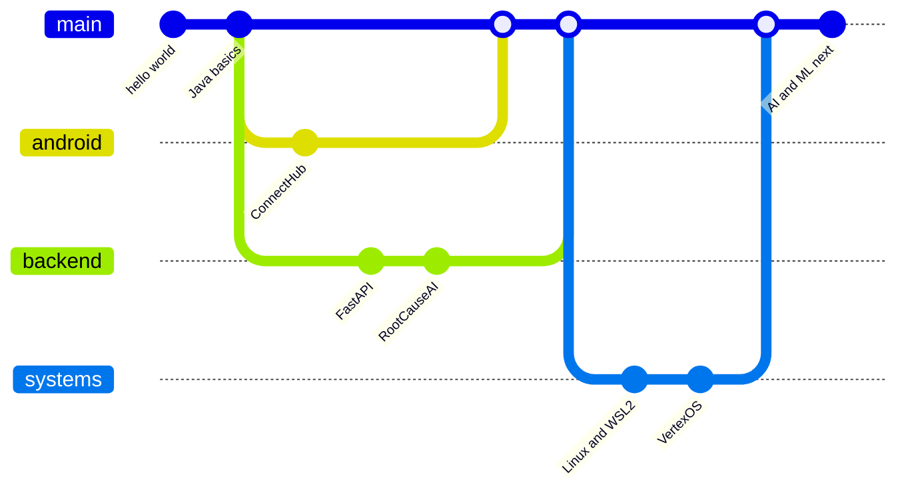

<div align="center">

  

  <br/>

  

  <br/><br/>

  
  
  
  

</div>


## `$ man indrajeet`

```text
INDRAJEET(1)                  Developer Manual                  INDRAJEET(1)

NAME
       indrajeet - student developer, builder of apps and backends

SYNOPSIS
       indrajeet [--learn] [--build] [--debug] [--repeat]

DESCRIPTION
       A Computer Science and Engineering student (graduating 2027) who
       learns by building. Writes Android apps in Java, backends in Python,
       and spends spare cycles exploring Linux and how operating systems
       work. Long-term heading: AI/ML engineering.

OPTIONS
       --learn     Study the concept before touching the keyboard
       --build     Turn the concept into a working project
       --debug     Trace every failure back to its root cause
       --repeat    Run until it works, then run again to improve it

SEE ALSO
       ConnectHub(1), RootCauseAI(1), VertexOS(7), coffee(8)

BUGS
       Known to restart bugs.service more often than documented.
       Considers this a feature.
```

---

## `$ ps aux | grep projects`

```text
PROJECT        STATE      WHAT IT DOES
ConnectHub     BUILT      Android chat and social app (Java + Firebase)
RootCauseAI    RUNNING    FastAPI + PostgreSQL backend for failure analysis
VertexOS       BOOTING    Learning OS fundamentals through Linux and WSL2
NeuroxTools    BUILT      Python tooling project
LinuxNetInfra  BUILT      Hands-on Linux networking setup
```

### ⚡ RootCauseAI

**Find out why software broke, not just that it broke.**

```text
 [log source] ──▶ [ FastAPI ] ──▶ [ PostgreSQL ]
                      │
                      ├── GET  /health ............. ✔ online
                      ├── POST /telemetry .......... ✔ online
                      │
                      ╰╌╌▶ anomaly detection ....... ◌ planned
                      ╰╌╌▶ event correlation ...... ◌ planned
                      ╰╌╌▶ root-cause suggestions . ◌ planned
```

<sub>Solid = built today. Dotted = planned, not claimed as finished.</sub>

`Python` · `FastAPI` · `PostgreSQL` · `Docker`

<div align="center">
  <a href="https://github.com/Indra9555/RootCauseAI">
    
  </a>
</div>

### 💬 ConnectHub

An Android chat and social app, written in Java with Firebase handling the backend.

`Java` · `Android` · `Firebase`

### 🖥️ VertexOS

A long-term journey from *using* Linux to *understanding* what runs underneath it.

```text
 ▸ boot stage 1   ████████░░   Ubuntu on WSL2, shell workflows, Git     [ACTIVE]
 ▸ boot stage 2   ░░░░░░░░░░   Low-level programming fundamentals       [QUEUED]
 ▸ boot stage 3   ░░░░░░░░░░   Boot process, memory, processes          [QUEUED]
 ▸ boot stage 4   ░░░░░░░░░░   A tiny kernel of my own                  [QUEUED]
```

---

## `$ git log --graph --oneline`



<sub>My learning history as a git graph: branches for Android, backends and systems, all merged into one developer.</sub>

---

## `$ htop`

```text
  1  [██████████████████░░░░]  Java ........ DSA practice + Android
  2  [███████████████░░░░░░░]  Python ...... FastAPI + scripting
  3  [█████████████░░░░░░░░░]  Android ..... ConnectHub, Firebase
  4  [████████████░░░░░░░░░░]  Git / Linux . daily workflow
  5  [██████████░░░░░░░░░░░░]  Databases ... PostgreSQL, Docker
  6  [██████░░░░░░░░░░░░░░░░]  AI / ML ..... fundamentals phase
  7  [████░░░░░░░░░░░░░░░░░░]  OS internals  just getting started

  Mem[|||||||||||||||||||||| curiosity 100%]
  Tsk: 7 running, 0 sleeping, ∞ bugs
```

<sub>Self-assessment of where my time goes, not a claim of mastery.</sub>

<div align="center">


</div>

---

## `$ cat ~/.lab/experiments`

**🔥 Git Commit Roaster.** A Python script that reads a repository's history and writes sarcastic comments on the commit messages.

```text
$ python roast.py --repo .
"fix"          →  Bold of you to assume anyone knows what was fixed.
"fix2"         →  The sequel nobody asked for.
"final_final"  →  Narrator: it was not final.
```
<sub>Sample output, for illustration.</sub>

**🌧️ Terminal Lyrics Reel.** A Python terminal animation of green ASCII digital rain with song lyrics glowing in the centre, made for an Instagram Reel. The rain in the banner above is a nod to it.

---

## `$ uptime --stats`

<div align="center">

  
  

  <br/><br/>

  

  <br/><br/>

  

</div>

---

## `$ cat ~/.history`

- **Jun to Jul 2026:** summer training at Netcamp Solutions
- **2026:** RootCauseAI foundation online · ConnectHub built · VertexOS begins
- **2027:** B.Tech CSE graduation
- **Always:** learn, build, debug, repeat

<details>
<summary><b>🔓 sudo access (click to elevate)</b></summary>

```text
$ sudo make me-a-sandwich
[sudo] password for indrajeet: ********
indrajeet is in the sudoers file. This incident will be reported.
...
Okay. Here is your sandwich. 🥪

$ echo "off duty: bike rides, tech articles, psychology, puzzles"
off duty: bike rides, tech articles, psychology, puzzles
```

</details>


<div align="center">

  <a href="https://github.com/Indra9555">
    
  </a>
  <a href="https://github.com/Indra9555?tab=repositories">
    
  </a>

  <br/><br/>

  ```text
  indrajeet@vertex:~$ logout   # not today
  ```

  **Learn continuously. Build deliberately. Improve relentlessly.**

</div>
